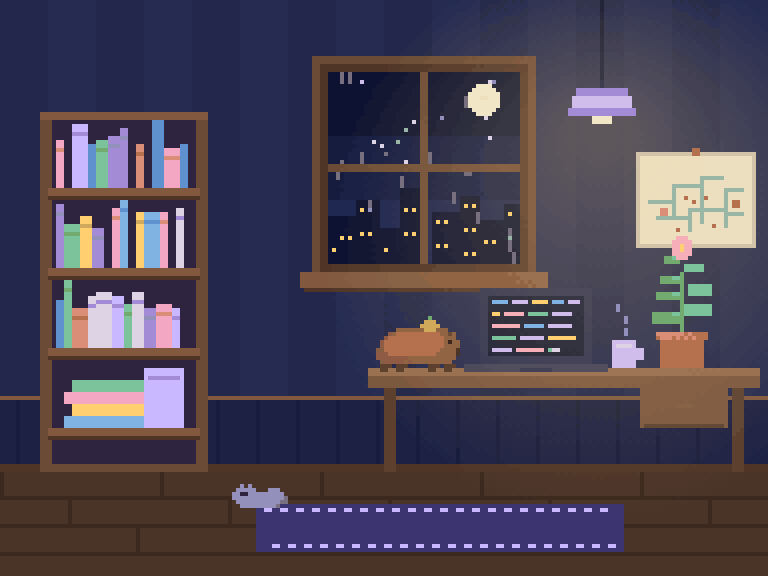
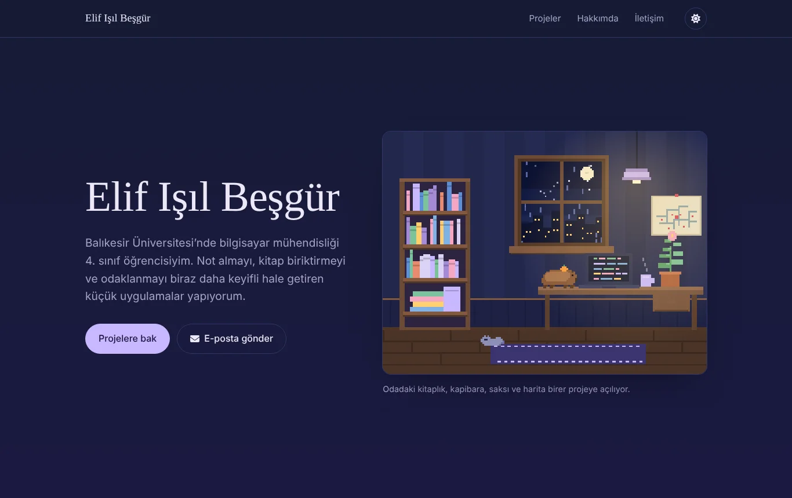
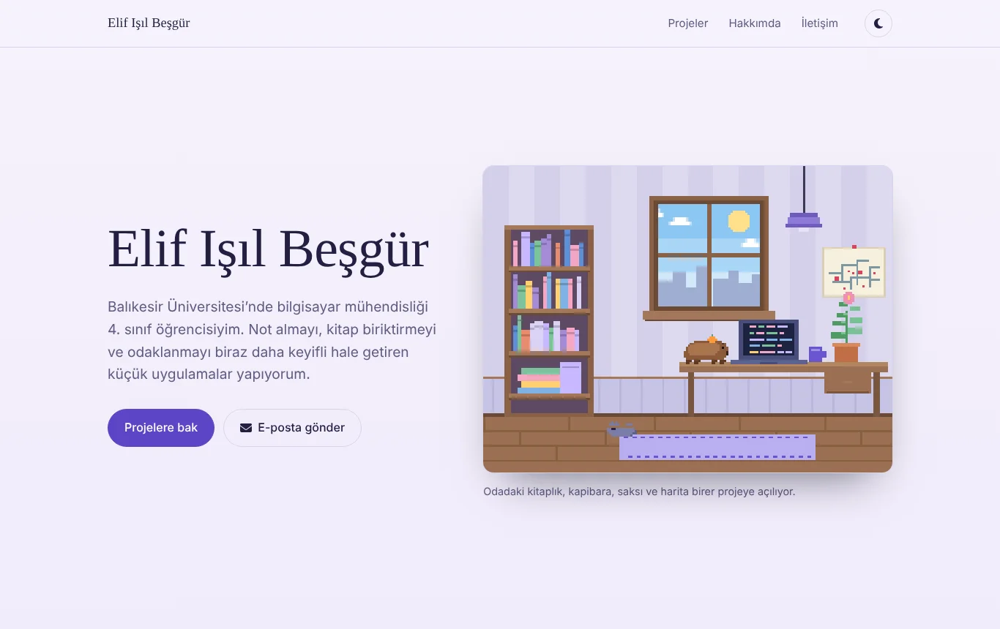

<div align="center">



# Elif Işıl Beşgür

Bilgisayar mühendisliği öğrencisi Elif Işıl Beşgür'ün kişisel portfolyo sitesi.

**[elifisilportfolyo.vercel.app](https://elifisilportfolyo.vercel.app)**


</div>

## Piksel oda

Sitenin girişinde kodla çizilmiş küçük bir çalışma odası var. Oda 192×144 piksellik bir
tuvale saniyede 14 kare çiziliyor ve keskin piksellerle büyütülüyor; hazır görsel kullanılmıyor.
Pencerede yağmur yağıyor, ekranda kod akıyor, kupadan buhar çıkıyor, halıda bir kedi uyuyor.

Odadaki eşyalar projelere açılıyor:

| Eşya | Açtığı proje |
|---|---|
| 📚 Kitaplık | [LumaRaf](https://github.com/elifisilbesgur/lumaraf) |
| 🦫 Kapibara peluşu | [Kapibara Uçuşu](https://github.com/elifisilbesgur/kapibara-ucusu-oyun) |
| 🪴 Saksı | [LumaNote](https://github.com/elifisilbesgur/lumanote) |
| 🗺️ Duvardaki harita | [Bursa Hazırlık Atlası](https://github.com/elifisilbesgur/Bursa-Deprem-Web-Uygulamas-) |

Tema değiştirilince oda da değişiyor: gündüz pencerede güneş ve bulutlar, gece yıldızlar,
yağmur ve şehir ışıkları görünüyor.

| Gece | Gündüz |
|:---:|:---:|
|  |  |

## Sitede neler var?

- **Projeler:** LumaNote, LumaRaf, Kapibara Uçuşu ve Bursa Hazırlık Atlası; ardından
  PyQt5 ile yapılmış önceki masaüstü uygulamaları.
- **Hakkımda:** Kısa tanıtım ve alanlara göre kullanılan araçlar.
- **İletişim:** Form, yazılan mesajı ziyaretçinin e-posta uygulamasında hazır olarak açar.
  Sunucuya veri gönderilmez.
- **Gece / gündüz teması:** Seçim tarayıcıda hatırlanır; ilk açılışta cihazın ayarı kullanılır.
- **Gradyan arka plan:** Aşağı kaydırdıkça gece mavisinden mor alacakaranlığa, oradan petrol mavisine geçer.
- Mobil uyum, klavyeyle gezinme ve "hareketi azalt" ayarı desteği.

## Çalıştırma

[Node.js](https://nodejs.org) kurulu olmalı.

```bash
npm install
npm start        # http://localhost:3000 adresinde geliştirme sunucusu
npm run build    # yayına hazır dosyalar build/ klasörüne
```

Vercel projesi bu repoya bağlı olduğu sürece `main` dalına yapılan her push siteyi yeniden yayınlar.

## Dosya yapısı

```
src/
  App.js         Sayfa düzeni, proje ve araç listeleri, tema ve iletişim formu
  PixelRoom.js   Canvas'a çizilen piksel oda ve tıklanabilir eşyalar
  index.css      Renkler (gece / gündüz), yazı tipleri ve duyarlı düzen
public/
  projects/      Proje görselleri
  image/         Profil fotoğrafı
docs/            Bu README'deki görseller
```

Yeni bir proje eklemek için `src/App.js` içindeki `PROJECTS` listesine bir kayıt ekleyip
görselini `public/projects/` klasörüne koymak yeterli.

## İletişim

[elifisilbesgur.bursa@gmail.com](mailto:elifisilbesgur.bursa@gmail.com) ·
[GitHub](https://github.com/elifisilbesgur) ·
[X](https://x.com/elifisilbesgur)
